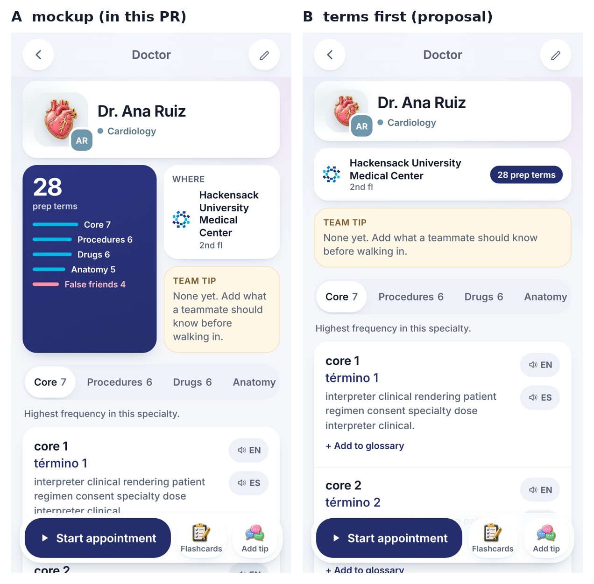

# D1 review: the doctor's page, measured

2026-10-14. What was measured against the approved mockup, what was fixed,
and what needs Jose. Tools: `tests/suites/doctor-page.cjs` (72 checks, runs
on every push), `tests/tools/doctor-replay.cjs` (real data), axe-core 4.10,
Chromium with a 4x CPU throttle. WebKit runs in CI (`webkit` job); this
container has no WebKit.

## Above the fold (the main finding)

Typical doctor = Doctor Prep's usual 28 terms. Worst = 37 terms (its
maximum), 25-word definitions, a long name, place, tip and specialty.
"Rows" = term rows fully visible above the glass bar on first open.

| Screen | A, mockup: first term at | rows | B, terms first: first term at | rows |
|---|---|---|---|---|
| 393x759 typical | 556px (bar at 675) | 0 | 436px | 1 |
| 393x759 worst | 658px | 0, text hidden | 524px | 0, text visible |
| 360x740 typical | 556px (bar at 656) | 0 | 453px | 1 |
| 360x740 worst | 674px | 0, text hidden | 539px | 0, text visible |

B: Where goes into one line under the header with the term count; the tip
is a full-width strip (2 lines); the navy tile goes (the tabs already carry
every count); the tabs stick under the top bar while scrolling. A term row is
about 175px, so no header layout gets three rows on screen: the rest is row
height. The biggest single cost is the "+ Add to glossary" line (about 40px
per row), which the mockup didn't have; it could become a third small pill
under EN / ES. **Jose (2026-10-20): picked B plus the smaller row, saw it built, and kept A for its look.** D1b keeps A, compacts its bento and keeps the smaller row: 1 full row on open for a typical doctor.

## Fixed in this PR, from the review

- **Contrast.** axe failed the WHERE and TEAM TIP labels (2.59 light, 3.78
  dark; AA is 4.5); tab counts and the bottom line also failed (2.4-2.96).
  Now: 0 axe violations on every tab, typical and worst doctor, light and dark.
- **Researched doctors looked unresearched.** The phone's saved copy of the
  directory has no research (a code comment said it was re-fetched on
  open; nothing did). Before the directory loads, or offline, the page said
  "Not looked up yet · Research this doctor", which costs an API call. Now
  it fetches that one doctor; offline it says the terms need a connection.
- **Wrong or no specialty for Flashcards / Start appointment.** Word overlap
  matched 20 of 37 common specialties (Cardiology missed "Heart Failure &
  Cardiac"; Psychiatry missed Mental Health). Hints first now: 31 of 37; the
  6 left (Internal, Family, Rheumatology, PM&R, Palliative, Allergy) have no
  domain in the glossary and get the specialty picker / a plain
  appointment. Add to glossary still uses the old matcher (follow-up).
- **Start appointment with the doctor you're already with** reopens that
  appointment instead of asking to replace it.

Speed: opening the worst doctor 52-144 ms, switching tabs 58-124 ms, at a
4x CPU throttle. Not a problem.

## Risks the mockup hides, and what I recommend

1. **Add tip edits one shared notes field.** Two people writing at once:
   the last save wins, and the tip shows whoever saved last as its author.
   D2 (a list of tips, each written on its own key with merge, like places)
   fixes it. Until then, low traffic makes it rare.
2. **Doctor Prep's Spanish looks as trusted as the glossary's.** Same size,
   same navy; only "In glossary" tells them apart. Recommend one line above
   research rows: "From Doctor Prep, not checked by the team." Jose said
   yes (2026-10-20); built in D1b.
3. **Speech on an iPhone without a Spanish voice** reads Spanish with an
   English voice. Untestable here. Check on a real phone (task 3 below);
   if it happens, the ES button should say so instead of mangling it.
4. **Adult urology, ENT, endocrinology and nephrology** land in the "Peds
   ENT, Urology, Endocrinology & Nephrology" domain, the only one there is.
   A glossary question, not a page one.

## Real data: needed from Jose

The replay script proves nothing is lost only on the data it gets; here it
ran on samples (45 terms, tiered, flat, empty tiers, duplicates, photo,
note: nothing lost, and it catches a dropped tier or dropped team terms).
For the real check:

1. On a computer, open https://interp-six.vercel.app in Chrome, go to Doctor
   Directory and wait for the list.
2. Press F12 (Mac: Cmd+Option+J), click Console, paste
   `copy(JSON.stringify(DOCTOR_DIRECTORY))` and press Enter.
3. Paste into a new text file `doctors.json` and send it in the chat. It
   holds the team's notes: it stays out of git.

Then: `cd tests && OLD=<main's index.html> node tools/doctor-replay.cjs doctors.json`.

## Interpreter test (5 minutes, 3 interpreters, their own iPhones)

Old = the live app before merge (or a teammate who hasn't updated); new =
after. Same doctor for everyone, one who has research. Time each task from
the tap that opens the doctor; note wrong taps.

1. "Find the Spanish for [a drug from the Drugs tier] and hear it." Time to
   the Spanish being heard.
2. "What's the one false friend to watch with this doctor?" Time to saying it.
3. "Play the Spanish of the first Core term." Does it sound Spanish? (voice check)
4. "Start the appointment with this doctor." Time, and did it land on the
   right specialty?
5. "Leave a tip for the team." Time; did they find it without help?

Write down: times, wrong taps, anything they say out loud. Old vs new
medians; 3 people is enough to see a 2x difference, not a 20% one.
